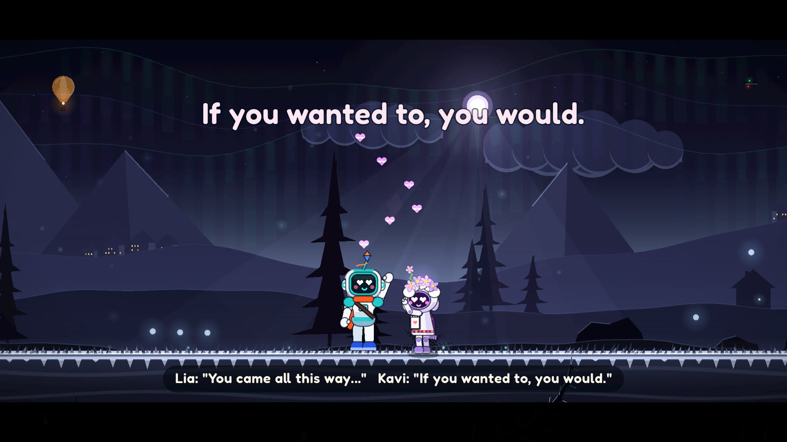
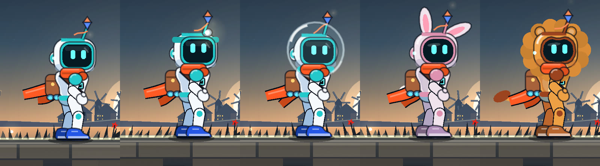
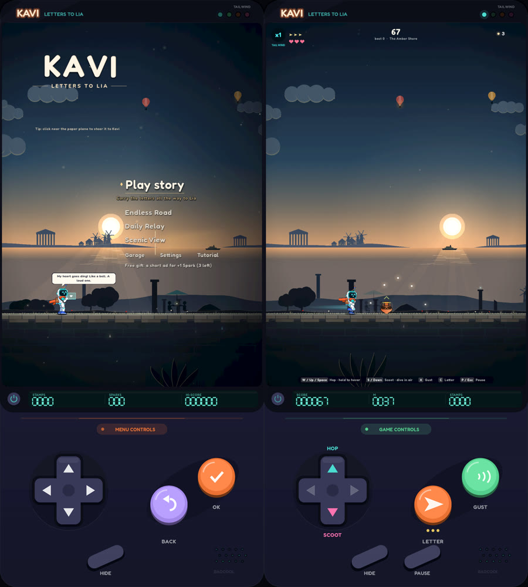

# KAVI: Letters to Lia



### A little robot. A long road. One letter that has to arrive.

**Kavi** (his name means *poet*) is a tiny courier robot with a screen for a face, a sunset-orange scarf and a bag full of letters. Lia is waiting at the other end of Europe. Between them: sea cliffs, lantern forests, a river of mirrors and mountains full of stars.

**A cozy, family-friendly 2D runner** that's quick to pick up and hard to put down. Every picture, song and sound in it is made in code: no stock art, no samples.

## ▶ Play free, right now

### **[Play in your browser](https://badcool-interactive.github.io/KAVI-Letters-To-Lia/)** · no install, no account

Or download it from **[Releases](../../releases/latest)**:

| Platform | File | How to run |
|---|---|---|
| Windows 10/11 | `KAVI-windows.exe` | Double-click it. It isn't signed yet, so SmartScreen may warn: choose *More info → Run anyway*. |
| Android | `KAVI-android.apk` | Open it on the phone and allow "install unknown apps". If Play Protect warns, choose *Install anyway* (preview build). |
| Linux | `KAVI-linux.x86_64` | `chmod +x KAVI-linux.x86_64 && ./KAVI-linux.x86_64` |

## Four countries, one journey


**The Amber Shore** (Greece) · **Lanternwood** (Bulgaria) · **Mirrorwater** (the Danube) · **Starfall Heights** (Romania)

Each country has its own sky, people, ground, obstacles, **its own song** and its own sounds: gulls and waves, a woodpecker in the forest, church bells across the river, cowbells in the mountains. The world flows from one country into the next as you run, and the sun sets behind the hills.

## Easy to learn, fun to master


Four moves, one thumb each: **Hop** (hold to hover), **Scoot** (dive in the air), **Gust** (blow things open) and **Letter** (a paper plane that rings bells and drops bridges).

- **Obstacles with personality:** a **runaway fruit cart** rolling straight at you, **pigeons** you can scoot under *or* gust away ("SHOO!"), a wobbly **parcel tower** with a cat napping on top, Greek amphoras, forest log piles, Danube barrels, mountain snowmen, gates, bells and bouncy blooms.
- **Tailwind:** perfect timing builds x2, x3, x4. **The music grows with you:** at high Tailwind a melody joins the song.
- **Always fair:** a solver bot checks every stretch of road can be cleared before you see it.
- **Fail and laugh:** when Kavi trips, he cries dramatically, kicks a rock, or faceplants.

## Dress him up



Kavi is really a tiny memory chip that moves into new suits: **Courier, Explorer, Astro Bubble, Bunny, Lion**, plus kitty, teapot, blocky and a whole zoo of animal costumes. Add paints, visors, faces, scarves, antennas, bags, trails and letter colours in the **Garage**. *Everything is free to try while the game is in development.*

## A pocket console on your phone



Hold your phone upright and KAVI becomes a **handheld console**:
- a neon marquee and Tailwind lights;
- an arcade-style score display;
- a D-pad and A/B buttons that work the menus and swap to game controls when you run;
- a vibration buzz under your thumb;
- a power button that saves and turns it off.

Turn the phone sideways for full-screen play.

## Modes
- **Story:** four chapters to Lia, with route choices, kind strangers, a rescue, and the reunion.
- **Endless Road** and **Daily Relay** (the same road for everyone, every day).
- **Scenic View:** no obstacles. Pick a country, a time of day and the sounds, and just watch Kavi run through Europe.
- **Tutorial:** 13 quick hands-on lessons; the game pauses until you try each move.


**The title screen is a toy too:** steer the paper plane to Kavi, click balloons, ships and birds, and read Kavi's little poems mixed with public-domain love lines from Shakespeare, Byron, Dickinson and Tagore. Wait too long and he pulls up a chair, or a bed.

## Controls

| Action | Keyboard | Gamepad | Touch / handheld |
|---|---|---|---|
| Hop (hold for higher; hold in the air to hover) | W / Up / Space | A | D-pad up · left thumb, upper half |
| Scoot (hold) · dive in the air | S / Down | B | D-pad down · left thumb, lower half |
| Gust (opens gates, shoos pigeons) | X | X | A button · big right button |
| Letter (paper plane: bells and bridges) | C | Y | B button · small right button |
| Pause / back | P / Esc / Backspace | Start | Pause button |

**Kind by design:**
- **Settings:** Kind Mode (no fails), hover assist, relaxed speed, reduced motion, a left-handed layout, bigger buttons, vibration on/off, and Modern or OG sound.
- **Privacy:** no tracking, no accounts, and no ads during gameplay.

## For developers

```bash
../../tools/bin/path/godot --path .                       # run from source (Godot 4.7.2)
tools/test.sh                                             # headless tests (isolated user data)
tools/capture.sh /tmp/shots                               # scripted screenshots
tools/render-music.sh                                     # re-render the songs (synth.gd compose()) to OGG
VOLT_CAPTURE_ARGS="--obs" tools/capture.sh /tmp/obs       # obstacle review in all four countries
tools/bench.sh /tmp/bench.json --quality=medium           # performance benchmark
```

Code map: `sim.gd` physics and moves · `track.gd` level generator plus a solver bot that checks every stretch is clearable · `main.gd` game flow, camera, HUD, title toys · `world_view.gd` sky, countries and living world · `track_view.gd` ground and obstacles · `kite_view.gd` Kavi · `chars.gd` Lia and friends · `synth.gd` music and sounds · `ui.gd` menus · `looks.gd` Garage items.

See [docs/CHANGELOG.md](docs/CHANGELOG.md) for everything that changed in each version.

## Credits
Made by **BADCOOL INTERACTIVE**. Fonts: Fredoka and Nunito (SIL Open Font License, in `assets/fonts/`). Title quotes are public-domain poetry, credited in game; the asset ledger is `docs/LEDGER.csv`.

---
© BADCOOL INTERACTIVE · made by Singh Baljeet · all rights reserved for the game, its characters and its art.
