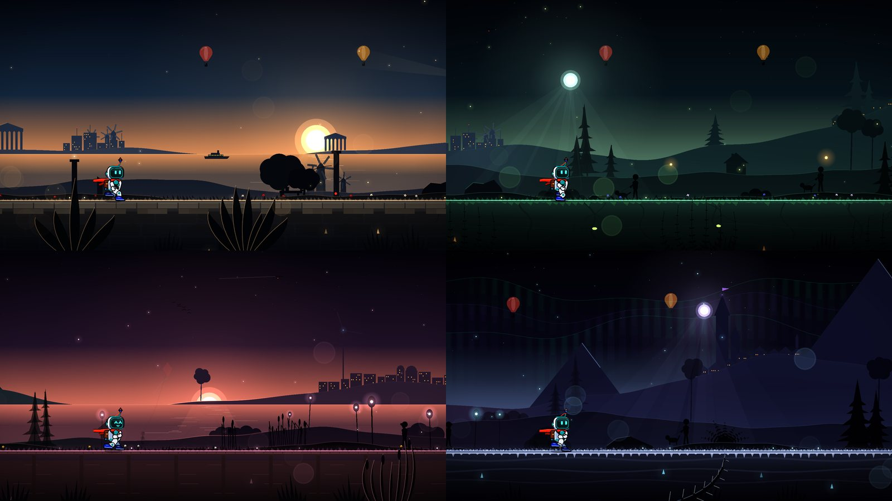
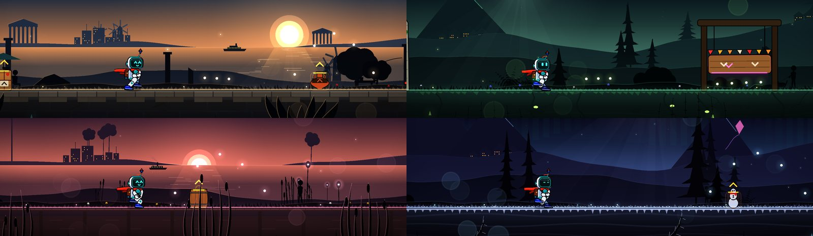
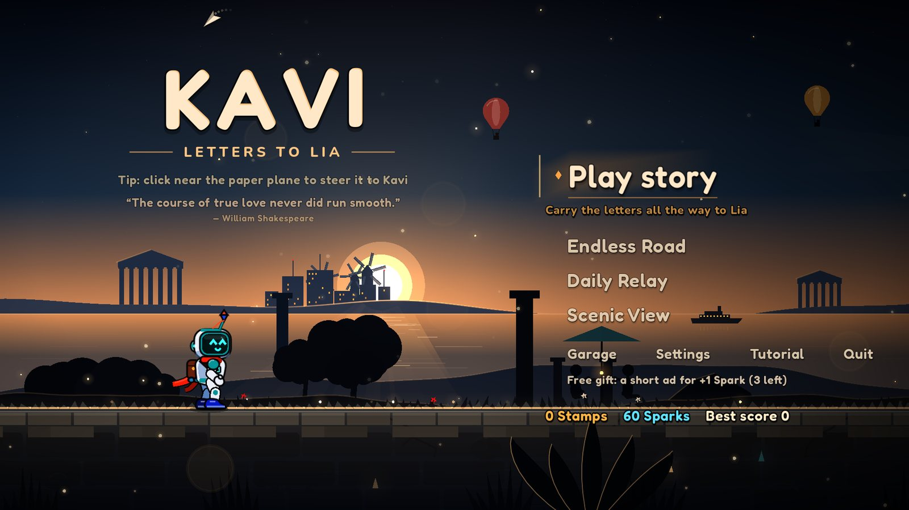

# KAVI: Letters to Lia


**Kavi** is a little courier robot (his name means "poet") with a screen for a face, a sunset-orange scarf and a bag full of letters. He runs across Europe, from the Greek coast through Bulgarian forests and along the Danube to the Romanian mountains, to reach his friend **Lia**.

A cozy, family-friendly 2D auto-runner made in Godot 4.7. Everything you see and hear (characters, worlds, obstacles, music) is generated in code.

*(This repo used to be the game VOLT/RUN; Kite and Lumi are now Kavi and Lia.)*

## ▶ Play now

**In your browser, no install: https://singh679.github.io/volt-run-luminous/**
Works on desktop, Android (Chrome) and iPhone/iPad (Safari). Turn your phone sideways.

**Download** the latest build from **[Releases](../../releases/latest)**:

| Platform | File | How to run |
|---|---|---|
| Windows 10/11 | `KAVI-windows.exe` | Double-click it. It isn't signed yet, so SmartScreen may warn: choose *More info → Run anyway*. |
| Android | `KAVI-android.apk` | Copy it to the phone, open it, and allow "install unknown apps". Play in landscape. |
| Linux | `KAVI-linux.x86_64` | `chmod +x KAVI-linux.x86_64 && ./KAVI-linux.x86_64` |

## A world to run through



Four countries, each with its own sky, music, people and ground: **The Amber Shore** (Greece), **Lanternwood** (Bulgaria), **Mirrorwater** (the Danube) and **Starfall Heights** (Romania). The world changes smoothly as you run, and the sun and moon set behind the hills.



Every country has its own obstacles: Greek amphoras and orange crates, forest log piles, Danube barrels and mountain snowmen to hop over; shop signs on gateways to scoot under; and gaps above the sea, ravines and ice. A perfect clear makes them wobble and burst into confetti.

## The title screen is a toy too



- **Paper-plane mini-game:** click near the plane to push it, and steer it to Kavi so it circles him. Click too fast and it stalls!
- **Click the sky:** balloons hop and wave (click three times quickly to send one flying), the plane draws a smoke heart, ships toot their horns, and birds scatter.
- **Kavi's notebook:** his own little poems, mixed with short public-domain love lines from Shakespeare, Byron, Dickinson, Tagore, Burns and others.

## Dress him up


Kavi is really a tiny memory chip that can move into new suits: Astro Bubble, Teapot, Bunny, Blocky, Sprout and more. Add paints, visor colours, scarves (stripes and rainbow) and antenna tips, all in the Garage. *Everything is free to try while the game is in development.*

## Modes
- **Story:** four chapters to Lia, with route choices (a countdown, and an easy option if you're unsure), breathers where kind strangers help, a rescue, and the reunion.
- **Endless Road** and **Daily Relay** (the same track for everyone each day).
- **Scenic View:** no obstacles, just Kavi running through all four countries.

## Controls

| Action | Keyboard | Gamepad | Touch |
|---|---|---|---|
| Hop (hold for higher; hold in the air to hover) | W / Up / Space | A | left thumb, upper half |
| Scoot (hold) · dive in the air | S / Down | B | left thumb, lower half |
| Gust (opens gates) | X | X | right thumb, big button |
| Letter (paper plane: bells and bridges) | C | Y | right thumb, small button |
| Pause / back | Esc | Start | top-right button |

Menus work with the mouse, touch, or WASD/arrows plus Enter, Space or E.

**Kind by design:** Kind Mode (no fails), hover assist, relaxed speed, reduced motion, a left-handed layout and bigger buttons. No tracking, and no ads in gameplay.

## For developers

```bash
../../tools/bin/path/godot --path .                       # run from source (Godot 4.7.2)
tools/test.sh                                             # headless tests (isolated user data)
tools/capture.sh /tmp/shots                               # scripted screenshots
VOLT_CAPTURE_ARGS="--obs" tools/capture.sh /tmp/obs       # obstacle review in all four countries
tools/bench.sh /tmp/bench.json --quality=medium           # performance benchmark
```

Code map: `sim.gd` physics and moves · `track.gd` level generator plus a solver bot that checks every stretch is clearable · `main.gd` game flow, camera, HUD, title toys · `world_view.gd` sky, countries and living world · `track_view.gd` ground and obstacles · `kite_view.gd` Kavi · `chars.gd` Lia and friends · `synth.gd` music and sounds · `ui.gd` menus · `looks.gd` Garage items.

See [docs/CHANGELOG.md](docs/CHANGELOG.md) for everything that changed in each version.

## Credits
Made by **Badcool Studio**. Fonts: Fredoka and Nunito (SIL Open Font License, in `assets/fonts/`). Title quotes are public-domain poetry, credited in game; the asset ledger is `docs/LEDGER.csv`.
